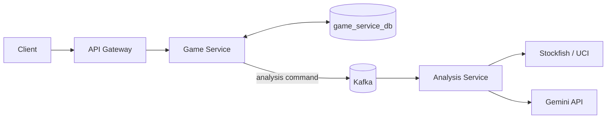

<div align="center">

# ♟️ ChessTracker Game Service

### The game-domain API: chess games, PGN data, persistence, and analysis commands.

[](https://openjdk.org/)
[](https://spring.io/projects/spring-boot)
[](https://www.postgresql.org/)
[](https://kafka.apache.org/)

[← ChessTracker](https://github.com/illia-krupko/chess-tracker) · [Analysis Service](https://github.com/illia-krupko/chess-tracker-analysis-service) · [Infrastructure](https://github.com/illia-krupko/chess-tracker-infrastructure)

</div>

---

## 🎯 Responsibility

Game Service owns chess-game domain operations in ChessTracker. It persists game data, validates game-related input, works with PGN/chess structures, and integrates with Kafka for analysis-related asynchronous work.

The service uses [chesslib](https://github.com/bhlangonijr/chesslib) for chess-specific functionality. Account management and compute-heavy engine analysis are handled by dedicated services.

## ✨ Core areas

- **Game-domain operations:** manage persisted chess-game data through the service API.
- **PGN and chess data:** process game notation and chess-related metadata.
- **Persistence:** PostgreSQL through Spring Data JPA / Hibernate.
- **Schema management:** Liquibase changelogs with Hibernate schema validation.
- **Asynchronous integration:** Kafka connectivity for analysis-related messaging.
- **Service security:** accept trusted internal identity through the Gateway path.
- **API exploration:** Springdoc OpenAPI UI and API documentation.

## 🔁 Position in the analysis workflow



The game request and engine calculation have separate lifecycles. Kafka carries analysis work so a game operation does not need to wait for all engine and AI processing to finish.

## 🛠️ Technology stack

- Java 21 · Spring Boot 4.1.1
- Spring Web MVC, Validation, Security
- Spring Data JPA / Hibernate
- PostgreSQL 17 · Liquibase
- Apache Kafka 4.1.2
- [chesslib 1.3.7](https://github.com/bhlangonijr/chesslib)
- Springdoc OpenAPI
- MapStruct · Lombok
- JUnit · Spring Boot test support · Testcontainers · Instancio · Checkstyle

## ⚙️ Configuration

The service imports an optional local `.env` file. Relevant settings:

| Variable / setting | Purpose |
|---|---|
| `SPRING_DATASOURCE_URL` | JDBC URL; default `jdbc:postgresql://localhost:5432/game_service_db` |
| `POSTGRES_USER` | Database username; local default `postgres` |
| `POSTGRES_PASSWORD` | Database password; local default `postgres` |
| `SPRING_KAFKA_BOOTSTRAP_SERVERS` | Kafka address; default `localhost:9092` |
| `SHARED_GATEWAY_SECRET` | Shared value used to validate the trusted Gateway path |

The application uses port `8081` and context path `/api` by default. The Gateway's default host destination for Game Service is `localhost:8082`; align the service port mapping and `GAME_SERVICE_URI`. Do not use local default database credentials outside a private local environment.

## 🚀 Run locally

### Prerequisites

- JDK 21
- PostgreSQL and Kafka from [ChessTracker Infrastructure](https://github.com/illia-krupko/chess-tracker-infrastructure)
- `SHARED_GATEWAY_SECRET` configured for the trusted internal request path

From this repository root:

```bash
./gradlew clean build
./gradlew bootRun
```

API documentation is configured at `/api/v3/api-docs`, with Swagger UI at `/api/swagger-ui` relative to the service host and port.

## 🔧 Design notes

Game Service owns game-domain persistence. It does not model a user by importing User Service's JPA entity or connecting directly to the user database. Trusted identity is passed through the Gateway boundary, and asynchronous analysis is carried through messaging rather than tightly coupling the game API to a long-running engine process.

## 🔗 Related repositories

[ChessTracker](https://github.com/illia-krupko/chess-tracker) · [User Service](https://github.com/illia-krupko/chess-tracker-user-service) · [Analysis Service](https://github.com/illia-krupko/chess-tracker-analysis-service) · [Statistics Service](https://github.com/illia-krupko/chess-tracker-statistics-service) · [API Gateway](https://github.com/illia-krupko/chess-tracker-api-gateway) · [Infrastructure](https://github.com/illia-krupko/chess-tracker-infrastructure)
